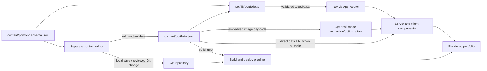

# Portfolio System Architecture

## Purpose and Scope

This document describes the current portfolio application and the intended JSON-backed content architecture. The public site remains a Next.js App Router application. Its content becomes data that can be edited by a separate tool; its presentation remains in components and styles.

The system separates three concerns:

1. **Content:** the profile, portfolio entries, every editable string, links, SEO values, articles, and image bytes maintained in JSON.
2. **Rendering:** Next.js routes and React components that turn validated content into pages.
3. **Editing and publishing:** a separate trusted workflow that changes JSON, validates it, and triggers the normal build/deploy pipeline.

## Current Application

- `src/app/layout.tsx` provides the root HTML shell, global fonts/styles, metadata, and site header.
- `src/app/page.tsx` assembles the home page and supplies project, writing, and contact data to section components.
- `src/app/writing/page.tsx` renders the writing catalog.
- `src/app/writing/[slug]/page.tsx` resolves an article, generates metadata/static params, handles canonical redirects, and renders the article body.
- `src/components/layout/` contains the masthead, navigation, social links, and theme control.
- `src/components/projects/` renders project cards and the interactive detail modal.
- `src/components/writing/` renders article previews; `src/components/contact/` renders contact links and email-copy interaction.
- `src/lib/config.ts` currently owns identity, navigation, socials, and project objects.
- `src/lib/articles.ts` currently reads Markdown files from `content/articles/` and parses YAML frontmatter with `gray-matter`.
- `src/types/index.ts` currently describes the shared project, social, article, and site shapes.
- Current state: `public/` contains static visual assets. In the target state, editable portfolio image bytes move into JSON; generated assets may be emitted from them during build.

Most routes are server components. Client components are used only where browser interaction is needed, such as the project modal, email copy button, navigation state, and theme toggle.

## Target Architecture

### Content Source

`content/portfolio.json` is the canonical source for all user-maintained content, including every displayed title and the actual bytes of every displayed portfolio image. It should contain a `schemaVersion` and explicit sections, such as:

- `site`: name, role, issue/edition label, site-level description and metadata.
- `navigation`: ordered navigation items and their destinations.
- `socials`: labels, destinations, and optional display handles.
- `home`: hero title/description/status text, calls to action, section copy, and image references. Titles such as "Systems Programmer" are ordinary JSON data, never JSX literals.
- `projects`: stable IDs, title, summaries, Markdown detail text, tags, status, year, repository/demo links, and image references.
- `writing`: writing index copy and article page labels.
- `articles`: stable slug, title, excerpt, date, category, tags, optional canonical URL/featured flag, and Markdown body string.
- `images`: stable image IDs, MIME type, base64/data URI payload, alt text, and any editable caption or focal-point metadata.

JSON owns all editable content values, not layout choices. Font choices, spacing, responsive rules, component structure, and interaction implementation stay in code. Image files under `public/` are not the source of truth for editable portfolio images. If large data URIs should not be emitted directly into page markup, a build step may extract/optimize them into generated assets; generated output must be reproducible from the JSON and safe to delete/recreate.

### Contract and Validation

`content/portfolio.schema.json` is the language-neutral contract shared by the site and future editor. It should constrain required fields, enums, primitive types, and arrays. `schemaVersion` gives migrations a clear starting point if the shape changes later.

`src/lib/portfolio.ts` is the only runtime boundary between raw JSON and rendering code. It validates the data, returns typed values, and provides focused lookups such as `getSiteContent()`, `getAllArticles()`, and `getArticleBySlug()`. Validation errors should identify the failing field and fail the build rather than quietly displaying incomplete content. Image validation includes supported MIME types, decodable base64, and configured size limits or warnings.

TypeScript types should be derived from the schema or checked against it so the schema and application cannot drift silently. Slugs and IDs must be unique. Article reading time may be calculated deterministically when it is not supplied as editorial data.

### Rendering and Routes

The App Router continues to compose pages. Routes request content through the loader and pass only the fields each section needs. Components remain presentational except for existing interaction state. They should not import the JSON directly or know the file's location.

Article routes continue using `slug` for `/writing/[slug]`, generate metadata and static params from the validated article list, and preserve canonical redirects. Article bodies remain Markdown strings; a dedicated renderer handles their display. This keeps long-form content ergonomic while the JSON remains the single stored source.

Global and page-specific SEO values come from the same content document. This prevents visible copy and metadata from diverging.

### Editing and Publishing

The editor is a separate application/tool that reads and writes the JSON format and validates against the shared schema. It communicates with the portfolio through the content file, not component props or a private React API. It edits all user-visible copy and image payloads, with image preview, upload/replace, alt-text editing, and payload-size feedback.

The recommended first workflow is local: edit the repository's JSON file, validate it, commit the change, and let the existing deployment build publish it. A hosted editor can be added later by creating an authenticated, reviewed Git branch or pull request. It must not expose repository credentials in browser code or attempt to mutate the deployed app's local filesystem.

The public application is read-only with respect to content. This is important because production builds and serverless/container deployments commonly use immutable or ephemeral filesystems. A JSON change on the host takes effect after a new build/deploy; live editing without deployment would require a separate content service and is not part of this design.

## Data Flow

1. A person edits the content using a JSON editor or future visual editor.
2. The editor validates the document against `portfolio.schema.json` and saves or proposes the JSON change.
3. Local/CI validation checks syntax, schema, unique IDs/slugs, and content invariants.
4. Next.js imports/loads the JSON through `src/lib/portfolio.ts` during build/rendering.
5. App Router pages pass minimal typed data to section components.
6. Next.js renders the portfolio; deployment publishes the build output and static assets.

## Quality Attributes and Constraints

- **Editable:** content and portfolio-image changes should not require changing TSX files or manually maintaining a separate authoritative asset file.
- **Portable:** JSON Schema is usable outside the Next.js app and can power an external editor.
- **Reliable:** invalid content fails early with useful diagnostics.
- **Reviewable:** content remains versioned in Git and changes are diffable/revertible.
- **Performant:** content is loaded from a local file at build/server render time; no per-request database/network dependency is introduced. Large embedded image payloads are size-checked and may be transformed into generated derivatives at build time.
- **Secure:** public rendering performs reads only; write access stays in a trusted local or authenticated Git workflow.
- **Stable URLs:** article slugs and canonical destinations are treated as compatibility-sensitive data.

## Deployment Model

The initial target is build-time JSON consumption. No API server or database is required. Content edits trigger the normal build/deployment process. If a future requirement demands instant updates without deployment, reassess the source of truth and introduce a managed content API/database explicitly rather than adding file writes to the deployed app.

## Key Decisions

- One canonical JSON document is preferred over separate JSON per content type because the stated goal is a single easily editable portfolio data file.
- Article text stays Markdown within JSON strings to preserve formatting and code blocks while meeting the single-file content requirement.
- Image bytes are embedded in JSON as base64/data URIs so the file remains the single editable content source. Build-generated optimized images are derivatives only.
- JSON Schema is the shared contract so an external editor is not tied to TypeScript.
- The Next.js app is a read-only renderer; publishing is handled through Git and deployment.
- UI design and behavior remain code; all portfolio information, editorial copy, and image content become data.

## Related Documents

- Implementation sequence and acceptance checks: [IMPLEMENTATION_PLAN.md](./IMPLEMENTATION_PLAN.md)
- Broader deferred dashboard/CMS ideas: [../FUTURE_EXPANSION_PLAN.md](../FUTURE_EXPANSION_PLAN.md)